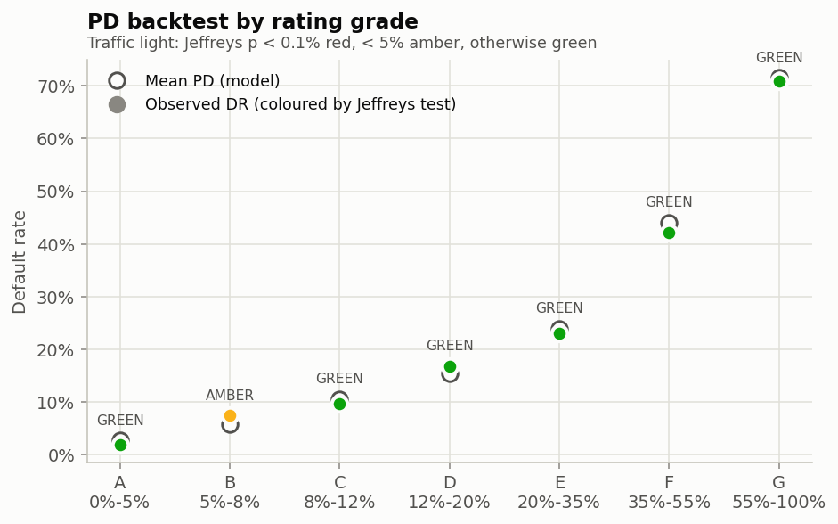
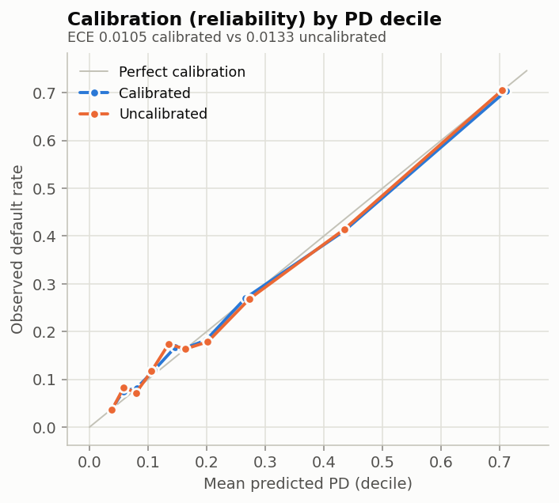
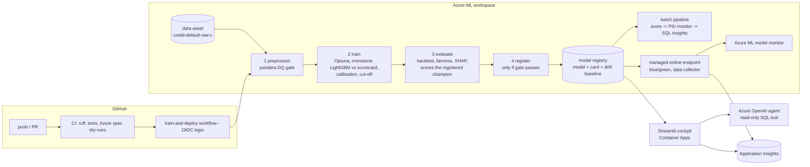
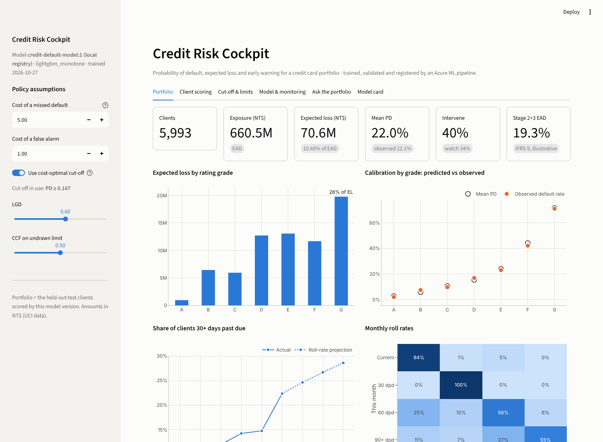

# Credit default PD engine on Azure ML

Predicts whether a credit-card client defaults on next month's payment (UCI *Default of Credit Card Clients*, 30,000 clients), as an Azure ML SDK v2 pipeline: **preprocess -> train -> evaluate -> register**, running on an Azure ML compute cluster, with the model registered in the workspace.

**In brief**
- **Pipeline**: four YAML components, submitted with the Python SDK v2 (`pipeline/run_pipeline.py`) or the CLI (`pipeline/training_pipeline.yml`). A compute cluster and versioned data asset are created automatically.
- **Model**: Optuna-tuned **monotonic LightGBM** vs. a logistic scorecard, selected out-of-fold, **calibrated** (isotonic + 0.1% PD floor), cut-off derived from misclassification costs.
- **Validation**: Gini/KS with bootstrap CIs, calibration, **PD backtest per rating grade (Jeffreys test)**, fairness check, **SHAP + reason codes**.
- **Registration**: gated **champion/challenger**. The registered version carries a model card, evaluation evidence and its own drift baseline.
- **Operations**: batch scoring + **PSI drift monitoring** pipeline, blue/green **online endpoint** with Application Insights and data collection, Azure ML model monitor, alerts, runbook, GitHub Actions CI/CD with OIDC.
- **Business layer**: expected loss, illustrative IFRS 9 staging, early-warning watchlist, limit steering, segments and roll rates in **SQL**, Power BI-ready tables.
- **Front end**: Streamlit cockpit with client what-if, cut-off economics, drift simulator and a **"talk to your portfolio" LLM agent** (guarded text-to-SQL, traced).

## Results (held-out test set, 5,993 clients)

| Metric | Value |
|---|---|
| ROC AUC (95% bootstrap CI) | **0.779** (0.765 - 0.792) |
| Gini / KS | 0.557 / 0.423 |
| Calibration error (ECE) / Brier / Hosmer-Lemeshow p | 0.0105 / 0.135 / 0.36 |
| PD backtest, 7 rating grades | 6 green, 1 amber (grade B), 0 red |
| Top 2 risk deciles | capture 50% of all defaults |
| At the cost-optimal cut-off (PD >= 0.167) | catches 71% of defaults while flagging 40% of clients; expected cost 49% below acting on nobody |

Out-of-fold model selection (training set, 5-fold): monotonic LightGBM AUC 0.789, unconstrained LightGBM 0.789, logistic scorecard 0.771. The monotonicity constraints cost no accuracy. Sex, marital status and age are not model inputs; they are only used for the fairness check.

<p>
 
</p>

## Architecture





## Case-study requirements

| Requirement | Where |
|---|---|
| Load, clean, preprocess with best practices | `src/preprocess.py`: pandera hard/soft checks, documented remapping of undocumented codes, de-duplication, stratified split before anything is fitted |
| Train, log training metrics | `src/train.py`: Optuna search, out-of-fold candidate comparison, calibrated refit, everything logged to MLflow |
| Load registered model + test data, evaluate, log metrics and plots | `src/evaluate.py`: evaluates the candidate and **loads the registered champion** to compare on the same test set; 12 charts |
| Pipeline with SDK v2 (or YAML + CLI) | both: `pipeline/run_pipeline.py` and `pipeline/training_pipeline.yml`, sharing `components/*.yml` |
| Create a compute cluster, submit, register the model | `run_pipeline.py` creates `cpu-cluster` (0-2 nodes) and the data asset; `src/register.py` registers `credit-default-model` |
| Bonus: YAML components, endpoint | `components/` (7 components), `deploy/deploy_endpoint.py` (blue/green, smoke test) |
| Screenshots | `docs/screenshots/` (pipeline run, registered model) |

## Beyond the brief: the senior data scientist role

| Responsibility | Implementation |
|---|---|
| Feature strategy | Utilisation, repayment-ratio and delinquency-pattern features inside the model pipeline (`creditrisk/features.py`), so there is no training/serving skew |
| Training / retraining | Monthly Azure ML schedule (`--schedule`), drift-triggered runs, champion/challenger gate |
| Calibration | `CalibratedClassifierCV` (isotonic, out-of-fold), PD floor, calibration slope / ECE / Hosmer-Lemeshow |
| Backtesting | Jeffreys test per grade with traffic lights; realised AUC vs. validation AUC on labelled batches |
| Drift monitoring | PSI per feature, score and rating grade vs. a baseline stored with each model (`src/monitor_drift.py`); Azure ML model monitor on the endpoint |
| Explainability | Exact TreeSHAP / linear SHAP per client, reason codes in batch output, endpoint response and app |
| Pipelines: testing, versioning, docs, incidents | 53 tests in CI, ruff, versioned data/model/environment, uv-locked dependencies, central config, model card per version, `docs/RUNBOOK.md` |
| Loss data, early warning, limit steering, clustering, portfolio insights | `creditrisk/policy.py` + SQL in `creditrisk/sql/`: EL, IFRS 9 staging, watchlist, limit actions, k-means segments, roll rates and a 3-month Markov projection |
| Python and SQL | Python package + DuckDB SQL, Power BI-ready output tables |
| GenAI "talk to your data" | `creditrisk/agent.py`: tool-calling agent with SELECT-only SQL, locked-down DuckDB, OpenTelemetry tracing; offline fallback |
| Monitoring, tracing, observability | MLflow in Azure ML, Application Insights (endpoint + app), OpenTelemetry spans, Azure Monitor alerts |

## Specification

`docs/SPEC.md` is the specification this build implements: business, data, model, validation, serving, monitoring, compliance (incl. EU AI Act) and engineering requirements, each with its acceptance test, plus a traceability table.

## Commands

Requires [uv](https://docs.astral.sh/uv/) (it installs Python 3.10–3.13 and the locked packages). Every `make` target is one line in the `Makefile`; the right-hand column runs the same thing without make.

| Target | What it does | Command |
|---|---|---|
| `make setup` | Install the locked environment, download the UCI data | `uv sync && uv run python scripts/download_data.py` |
| `make check` | Format check, lint and 53 tests (what CI runs) | `uv run ruff format --check . && uv run ruff check . && uv run pytest -q` |
| `make format` | Format and apply safe lint fixes | `uv run ruff format . && uv run ruff check . --fix` |
| `make local` | Every pipeline step locally, MLflow registry on SQLite (~3 min) | `uv run python scripts/run_local.py` |
| `make analytics` | Feature analysis (IV, default rate by bin) and portfolio risk figures → `docs/analytics/` | `uv run python scripts/risk_analytics.py` |
| `make app` | Streamlit cockpit | `uv run streamlit run app/streamlit_app.py` |
| `make deck` | Rebuild the offline presentation | `uv run python docs/presentation/build.py` |
| `make azure-setup` | Resource group, workspace, GitHub OIDC (see `docs/AZURE_SETUP.md`) | `bash infra/setup_azure.sh` |
| `make train` | Training pipeline on Azure ML, streams logs | `uv run python pipeline/run_pipeline.py --wait` |
| `make batches` | Stable and downturn demo batches | `uv run python scripts/make_batches.py` |
| `make batch-monitor` | Batch scoring + drift monitor on the downturn batch | `uv run python pipeline/run_batch_pipeline.py --batch data/batches/portfolio_downturn.csv --wait` |
| `make deploy` | Blue/green deployment of the latest registered model | `uv run python deploy/deploy_endpoint.py` |
| `make invoke` | Score `deploy/sample_request.json` on the endpoint | `az ml online-endpoint invoke -n <endpoint> -r deploy/sample_request.json -g rg-credit-risk -w mlw-credit-risk` |
| `make delete-endpoint` | Delete the endpoint (stops hourly billing) | `uv run python deploy/deploy_endpoint.py --delete` |
| `make lock` | Relock; regenerate the Azure and container environment files | `uv lock && uv run python scripts/lock_env.py`, then the `uv export` line in the `Makefile` |

Parameters (costs, LGD/CCF, PD floor, master scale, registration gate, drift thresholds, training and Azure settings) live in `src/creditrisk/config.yaml`; command-line flags and `AZURE_*` / `AZUREML_*` environment variables override them.

## Repository layout

```
components/        7 Azure ML command components (YAML) - single source of truth
pipeline/          SDK v2 submitters (training, batch monitoring, schedules) + CLI pipeline YAMLs
src/               pipeline steps: preprocess, train, evaluate, register, score_batch, monitor_drift, portfolio_insights
src/creditrisk/    shared library: schema, quality, features, modeling, explain, metrics, policy, drift, insights (+ sql/), agent, observability
src/creditrisk/config.yaml   business (costs, LGD/CCF, PD floor, master scale, gate, monitoring thresholds) and technical (data, training, Azure) parameters
src/serving/       online endpoint scoring script
deploy/ monitoring/ infra/   endpoint (blue/green), Azure ML model monitor, workspace bootstrap + alerts
app/ Dockerfile    Streamlit cockpit and its container
environments/      locked conda environments (training/scoring, serving)
.github/workflows/ ci, train-and-deploy, batch monitoring, app deploy
docs/              Azure setup, runbook, example model card, images, analytics/ (feature report, portfolio risk), presentation.html (offline deck; rebuild: make deck)
```

## Notes
- The UCI target is next-month payment default, not the regulatory 90-days-past-due definition, so PDs are recalibrated before any IFRS 9 / IRB use. LGD, CCF and cost ratios are explicit assumptions in place of internal loss data.
- One cross-sectional 2005 snapshot means no out-of-time sample; the drift monitor and labelled-batch backtests cover that in operation.
- `PAY_0` is renamed `PAY_1` to align with `BILL_AMT1` / `PAY_AMT1`. The raw panel almost never records a 1-month delay before the latest month (a known coding quirk), which shows in the roll-rate matrix.
- Amounts are in NT$ (dataset currency).
